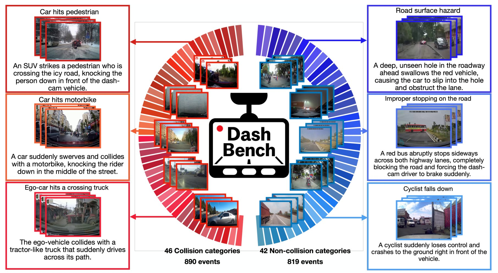
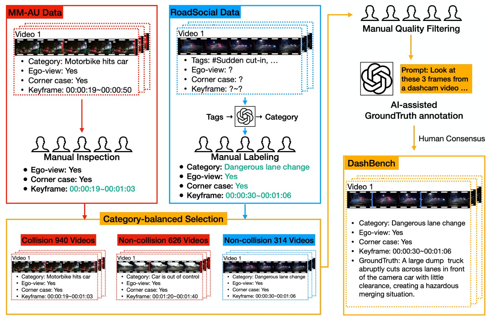

# DashBench: Evaluating Video LLMs' Understanding of Corner Cases in Autonomous Driving

<div align="center">
  <p>
    Gabriel Manalu, Minh Son Hoang, Hyeontaek Hwang, Jaesung Lee, Hyojin Choi, Tran Tuan Phong, Seon Kwon Kim,
    Saad Wazir, Daeyoung Kim
  </p>
  <p>School of Computing, KAIST, Daejeon, Korea</p>
  <h3>BMVC 2026</h3>

[](https://arxiv.org/abs/2611.16767)
[](https://cornercase-dashbench.github.io)
[](https://huggingface.co/datasets/gabrieldavin23/cornercase-dashbench)
[](LICENSE)

</div>

---

<p align="center">
  
</p>

## Abstract

*Natural language explanations promised by modern Video Large Language Models (Video LLMs) offer autonomous driving systems a path toward detailed scene description and interpretable decision making on the road. While recent benchmarks have begun assessing these models on driving scenes, they mainly target routine traffic conditions and general comprehension tasks based on existing driving datasets and therefore fail to evaluate model performance on the rarest and most safety-critical driving events, also known as "corner cases". To provide a comprehensive evaluation of Video LLMs on precisely these scenarios, we introduce DashBench, a benchmark testing 25 Video LLMs on 1,709 carefully curated driving videos spanning not only collision-related corner cases but also rare non-collision ones. Through extensive prompts and open-ended question answering, we expose a critical capability gap: all evaluated models perform substantially below the threshold required for safety-critical driving applications, frequently misjudging or missing dangerous events on the road ahead and hallucinating non-existent agents or actions in their explanations.*

## Overview

| | |
|---|---|
| Clips | **1,709** ego-view dashcam clips (MM-AU 1,395, RoadSocial 314) |
| Categories | **88**: 46 collision and 42 non-collision corner cases (890 / 819 clips) |
| Input | 16 frames per clip, uniformly sampled across the clip (`full`) or inside the annotated corner-case window (`ccw`, 823 clips) |
| Prompts | 5 open-ended prompts (Q1–Q5) per clip, 8,545 clip–prompt pairs |
| Judge | DeepSeek-V3 compares each response with the ground truth: same core cause, effect and timing of the danger? Yes/No (Cohen's κ = 0.96 with humans) |
| Models evaluated | 25 Video LLMs: 2 closed-source, 16 open-source, 7 driving specialists |

Each clip was manually verified to contain a visually identifiable, self-contained corner case, annotated with keyframes, and given a one-sentence ground-truth description drafted with OpenAI o3 and refined to consensus by three annotators.

<p align="center">
  
</p>

## Results

Accuracy (%) of the top 10 of 25 Video LLMs on all 1,709 clips, ranked by Avg. Q4R is the reasoning of the JSON prompt, Q4TF its binary detection answer, and Avg the mean over the prompts a model was evaluated on. The full table of 25 models is in the [paper](https://arxiv.org/abs/2611.16767).

| Model | Q1 | Q2 | Q3 | Q4R | Q5 | Avg | Q4TF |
|---|---|---|---|---|---|---|---|
| GPT-5 | 19.95 | 36.92 | 31.19 | 46.52 | 39.15 | 34.75 | 97.83 |
| Gemini-3-Flash | 32.36 | 35.28 | 29.84 | 39.58 | 34.99 | 34.41 | 94.85 |
| Qwen3-VL (235B) | 18.72 | 20.19 | 16.79 | 25.92 | 21.71 | 20.67 | 72.03 |
| Qwen3-VL (8B) | 18.90 | 15.51 | 14.45 | 22.00 | 21.53 | 18.48 | 74.96 |
| Qwen3-VL (32B) | 17.20 | 18.90 | 12.87 | 18.78 | 18.31 | 17.21 | 71.04 |
| Ovis2.5 (9B) | 19.68 | 15.41 | 7.77 | 18.72 | 20.55 | 16.43 | 64.47 |
| InternVL3.5 (241B) | 19.31 | 12.81 | 11.47 | 19.13 | 17.61 | 16.07 | 76.36 |
| InternVL3.5 (38B) | 12.64 | 13.22 | 8.66 | 16.44 | 12.93 | 12.78 | 77.65 |
| Tarsier2 (7B) | 13.28 | 13.11 | 11.70 | – | 12.35 | 12.61 | – |
| MiniCPM4.5 (8B) | 13.34 | 11.18 | 6.38 | 17.27 | 13.53 | 12.34 | 87.53 |

## Dataset

DashBench is hosted on [Hugging Face](https://huggingface.co/datasets/gabrieldavin23/cornercase-dashbench). It has two splits:
`full` (1,709 clips) and `ccw` (823 clips whose 16 frames are sampled inside the corner-case window). The text of each
clip is shown in the dataset viewer, and the frames are stored as Parquet files next to it.

`code/prepare_dataset.py` downloads the dataset and arranges it in the layout the evaluation code reads:

```bash
pip install -r requirements.txt
python code/prepare_dataset.py                 # both splits, about 6 GB
python code/prepare_dataset.py --split ccw     # only the corner-case-window split
```

```
dataset/
├── full_data.json         8,545 entries: 1,709 clips × 5 prompts
├── ccw_data.json          4,115 entries: 823 clips × 5 prompts
├── MMAU/{sampled_frames_16,corner_case_window}/<clip>/images/*.jpg
└── RoadSocial/{sampled_frames_16,corner_case_window}/<clip>/images/*.jpg
```

Each entry looks like this:

```json
{
  "ID": "MMAU_000848_n_frames_16_Q1",
  "dataset": "MMAU",
  "source_id": "000848",
  "image_folder": "dataset/MMAU/sampled_frames_16/000848/images",
  "n_frames": 16,
  "image_filenames": ["000001.jpg", "000004.jpg", "..."],
  "prompt": "What is unusual in this sequence of frames?",
  "prompt_type": "Q1",
  "ground_truth": "...",
  "category": "car scratches truck"
}
```

## Evaluation

Run every step from the repository root, with `dataset/` prepared as above. A model's responses go through four steps:
run the model, convert its responses into judge prompts, and judge them with DeepSeek-V3.

### 1. Set up API keys

```bash
pip install -r requirements.txt
```

The scripts read your own API keys from text files in `api_key/`, which is ignored by git:

| Used for | Key file |
|---|---|
| OpenAI models such as GPT-5 | `api_key/openai_key.txt` |
| OpenRouter models such as Gemini-3-Flash, and the DeepSeek-V3 judge | `api_key/openrouter_key.txt` |

```bash
mkdir -p api_key
echo "YOUR_OPENAI_API_KEY" > api_key/openai_key.txt
echo "YOUR_OPENROUTER_API_KEY" > api_key/openrouter_key.txt
```

Use `--api-key-path` to read a key from another file. A local server (such as vLLM) needs no key.

### 2. Run a model

Every model is reached through an OpenAI-compatible endpoint. Use `--split ccw` for the corner-case-window split.

```bash
# GPT-5, OpenAI API
python code/main_api.py --model gpt-5-2025-08-07 --split full

# Gemini-3-Flash, through OpenRouter
python code/main_api.py --model google/gemini-3-flash-preview --split full \
  --openai-base-url https://openrouter.ai/api/v1 --api-key-path api_key/openrouter_key.txt

# an open-source model served locally with vLLM. The 16 frames go in as one 1 fps video (needs ffmpeg)
vllm serve Qwen/Qwen3-VL-8B-Instruct --port 8000 --limit-mm-per-prompt '{"video": 1}' --allowed-local-media-path /tmp
python code/main_api.py --model Qwen/Qwen3-VL-8B-Instruct --split full --openai-base-url http://localhost:8000/v1

# a local model without video support: send the frames as images instead
vllm serve <model> --port 8000 --limit-mm-per-prompt '{"image": 16}'
python code/main_api.py --model <model> --split full --openai-base-url http://localhost:8000/v1 --input-mode images
```

- `--input-mode`: `auto` (default) sends a video to a local server and images to OpenAI and OpenRouter; or choose `images` / `video`
- `--question-types`: `all`, or a list such as `Q1,Q3`
- `--test`: run only the first 30 entries
- `--dry-run`: check the input files and build the requests without calling any model
- `--guided-json`, `--disable-thinking`, `--system-in-user`: options for some vLLM models

Responses are saved to `results/<split>/<model>/<split>_<model>.json`. Running the same command again resumes any
missing entries. The scripts reach models through OpenAI-compatible endpoints, so a model that is not served by such an
endpoint needs its own inference code and is not part of this repository.

### 3. Convert the responses into judge prompts

```bash
python code/convert_to_judging_format.py results/full/gpt-5-2025-08-07/full_gpt-5-2025-08-07.json
```

For Q1, Q2, Q3 and Q5 the whole response is judged. For Q4 the JSON answer is parsed: its `reasoning` is judged (Q4R) and
`unusual_or_dangerous_event_detected` is kept for the detection score (Q4TF). The judge prompt is the one in the paper.

### 4. Judge the responses with DeepSeek-V3

```bash
python code/judge_api.py results/full/gpt-5-2025-08-07/for_judging/
```

The judge replies are saved to `results/full/gpt-5-2025-08-07/judge/`. Accuracy is the share of entries whose
`format_classification` is `starts_yes`. Use `--dry-run` to see what would be judged without calling the judge.

## Citation

```bibtex
@misc{manalu2026evaluatingvideollmsunderstanding,
      title={Evaluating Video LLMs' Understanding of Corner Cases in Autonomous Driving}, 
      author={Gabriel Manalu and Minh Son Hoang and Hyeontaek Hwang and Jaesung Lee and Hyojin Choi and Tran Tuan Phong and Seon Kwon Kim and Saad Wazir and Daeyoung Kim},
      year={2026},
      eprint={2611.16767},
      archivePrefix={arXiv},
      primaryClass={cs.CV},
      url={https://arxiv.org/abs/2611.16767}, 
}
```

## License

The code in this repository is released under the [MIT License](LICENSE).

DashBench clips are derived from [MM-AU](https://github.com/jeffreychou777/LOTVS-MM-AU) and [RoadSocial](https://roadsocial.github.io/). Please consider their licenses and usage requirements.
